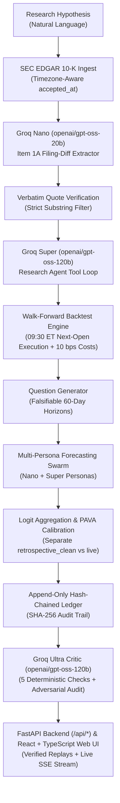

# ALBUS: Quant Research Copilot + Self-Calibrating Forecasting Swarm

[](https://opensource.org/licenses/MIT)
[](https://www.python.org/)
[](https://groq.com)
[](https://react.dev)
[](https://github.com/One-Hat/Albus/actions)

---

## 1. Overview & Architecture

> **ALBUS** turns natural language investment hypotheses into rigorous, lookahead-free SEC 10-K filing backtests, then transforms the discovered signals into falsifiable probabilistic forecasts scored in an append-only, SHA-256 hash-chained ledger.

Financial chatbots frequently hallucinate plausible-sounding investment rationales without empirical backing. ALBUS bridges qualitative corporate disclosures and quantitative factor analysis with strict verification gates:

1. **Verbatim Ground Truth:** Ingests raw SEC EDGAR 10-K filings (`54` real filings across `20` S&P 500 tickers) and enforces that every extracted claim maps to an exact verbatim substring in the source filing.
2. **Tri-Tier Model Architecture on Groq Cloud:** Distributes cognitive workloads across open-weights reasoning models running live on the **Groq API** (`https://api.groq.com/openai/v1`) as configured in [`config/models.yaml`](config/models.yaml):
   - **Nano Tier (`openai/gpt-oss-20b`):** High-throughput Item 1A risk-diff extraction and fast swarm persona forecasting.
   - **Super Tier (`openai/gpt-oss-120b`):** Quantitative research agent tool loop, hypothesis refinement, and deep-reasoning swarm personas.
   - **Ultra Tier (`openai/gpt-oss-120b`):** Skeptical adversarial critic auditing backtests for lookahead bias, multiple-testing $k$ variants, missing transaction costs, small sample sizes, and mixed calibration kinds.
   - *(Note: Originally conceived during a Nebius hackathon where API access required pre-funded credit-card billing, ALBUS was engineered and executed end-to-end on Groq Cloud's open-source model endpoints. See [`FEEDBACK.md`](FEEDBACK.md) for details.)*
3. **Strict No-Lookahead Execution:** Every trade executes strictly at the next market open ($09:30\text{ ET}$) after the SEC acceptance timestamp (`accepted_at`), enforced at runtime by `LookaheadBiasError` and tested continuously by `test_no_lookahead`.
4. **Self-Calibrating Swarm & Cryptographic Ledger:** Specialized personas emit probabilistic forecasts (`p_yes` in `[0.02, 0.98]`), aggregated in log-odds space with multiplicative Brier-score weighting and Pool-Adjacent-Violators (PAVA) isotonic calibration, and recorded in a tamper-evident SHA-256 hash-chained ledger. Retrospective (`retrospective_clean`) and live (`live`) calibration histories are strictly separated and never pooled.
5. **Full-Stack Type Contract & Source Provenance (`REAL` vs `MOCK`):** Backend (`src/`, `api/`) and Frontend (`web/`) share a single locked schema contract ([`contracts/types.ts`](contracts/types.ts) `v1.0`, mirrored in [`src/api/models.py`](src/api/models.py) and guarded against drift by `tests/test_contracts_drift.py`). Every metric displayed in the UI carries an explicit `REAL` or `MOCK` source badge; `MOCK` data is never labeled as `REAL`.

---

## 2. Pipeline Diagram



---

## 3. Implemented Modules & Build Gates

| Phase | Module | Key Capabilities | Gate Status |
| :--- | :--- | :--- | :--- |
| **Phase 0** | **Setup & Rules** | MIT License, `.gitignore`, `.env.example`, secret scanner (`scripts/check_secrets.py`), `AGENTS.md` rules. | Passed |
| **Phase 1** | **LLM Client & Cache** | Async OpenAI-compatible client (`src/llm/client.py`) configured for Groq (`GROQ_API_KEY`), reasoning field extraction, concurrency semaphore (10), `Retry-After` backoff, and SHA-256 disk cache. | Passed |
| **Phase 2** | **Data Layer** | SEC EDGAR fair-access ingest ($\le 10$ req/s), Item 1A Risk Factors parser (`src/data/sections.py`) with timezone-aware acceptance stamps, split-adjusted price loader (`src/data/prices.py`). | Passed |
| **Phase 3** | **Filing-Diff Extractor** | Groq Nano (`openai/gpt-oss-20b`) extraction of added/removed risks (`src/extract/diff_extractor.py`), Pydantic schema repair loop, and deterministic verbatim quote verification. | Passed |
| **Phase 4** | **Backtest Engine** | Decile long/short walk-forward simulation (`src/backtest/engine.py`), 10 bps transaction cost modeling, Sharpe, max drawdown, turnover, bootstrap 95% CI, and `LookaheadBiasError` enforcement. | Passed |
| **Phase 5** | **Research Agent** | Autonomous tool loop (`src/agent/research_agent.py`) with `run_backtest`, `get_stats`, `plot`, `list_filings`, $k$ variant tracker, and iteration caps. | Passed |
| **Phase 6** | **Forecasting Swarm** | 11 agent personas (8 Nano + 3 Super in `src/swarm/agents.py`), automated question generator (`src/swarm/questions.py`), and SHA-256 hash-chained ledger (`src/swarm/ledger.py`). | Passed |
| **Phase 7** | **Calibration & Resolver** | Logit aggregation (`src/swarm/aggregator.py`), PAVA isotonic calibrator (`src/swarm/calibrate.py`), Brier score tracking, and maturation resolver (`src/swarm/resolver.py`). | Passed |
| **Phase 8** | **Adversarial Critic** | 5 deterministic checks (`src/critic/checks.py`) + Groq Ultra (`openai/gpt-oss-120b`) adversarial auditor (`src/critic/critic.py`) with hard failure overrides. | Passed |
| **Phase B0-B4** | **Contract, Replay Exporter & FastAPI** | Locked `contracts/types.ts` v1.0 + `src/api/models.py`, integrity-gated `scripts/export_replay.py`, FastAPI endpoints (`src/api/app.py`) with rate limits, ticker allowlist, and SSE stage streaming, plus `docs/VERCEL_FEASIBILITY.md`. | Passed |
| **Frontend** | **React + TypeScript Web UI** | Vite + React 19 + TypeScript + Tailwind CSS dashboard (`web/`) with `SourceBadge` (`REAL`/`MOCK`), `EquityCurveChart`, `CalibrationPanel`, `EvidenceInspector`, `StagePipelineModal`, and Vitest test suite. | Passed |

---

## 4. Real Empirical Audits & Live Groq Benchmark Metrics

Per `AGENTS.md` Rule 8, every number below comes directly from executing [`scripts/validate_real_data.py`](scripts/validate_real_data.py), [`scripts/run_real_backtest.py`](scripts/run_real_backtest.py), and [`scripts/run_benchmarks.py`](scripts/run_benchmarks.py) against real SEC 10-K filings, real split-adjusted daily market prices, and the live **Groq API**.

### 4.1 Real SEC 10-K Data & Walk-Forward Backtest Audit (`results/real_data_validation.json` & `results/real_backtest_sanity.json`)
- **SEC 10-K Filings Evaluated:** `54` real 10-K filings across `20` S&P 500 tickers (`2023`–`2026`).
- **Item 1A Parse Success Rate:** `100.0%` (`54 / 54` parsed cleanly with timezone-aware `accepted_at` timestamps; `0` missing/odd timestamps).
- **Walk-Forward Trade Events:** `35` actionable YoY filing events (`19` earliest baseline filings dropped because YoY change requires a prior year $t-1$ baseline).
- **Baseline Signal Evaluated (Non-LLM Plumbing Sanity Test):** YoY percentage change in Item 1A character length, executed at next trading day open ($09:30\text{ ET}$) with `10 bps` transaction costs over a `60-trading-day` horizon:
  - **Sharpe Ratio:** `-0.1433` (95% Bootstrap CI: `[-0.8562, +0.5367]`)
  - **Max Drawdown:** `82.18%` (`0.8218`)
  - **Turnover:** `1.0000`
  - **Total Return:** `-63.64%` (`-0.6364`)
  - **Total Cost Drag:** `0.0700` (`7.00%` cumulative across rebalances)
  - **Audit Verdict:** `weak` — all deterministic integrity checks pass (zero lookahead, 10 bps costs deducted, 35 events $\ge 30$ minimum), but raw character-length expansion without semantic risk-diff filtering has a 95% Sharpe CI spanning zero.

### 4.2 Live Groq LLM Benchmark Suite (`results/benchmarks.json`)

Executed live on Groq (`openai/gpt-oss-20b` for Nano; `openai/gpt-oss-120b` for Super & Ultra) via `python scripts/run_benchmarks.py`:

| Benchmark Pillar | Metric | Nano (`openai/gpt-oss-20b`) | Super (`openai/gpt-oss-120b`) | Ultra (`openai/gpt-oss-120b`) / Swarm | Source Artifact |
| :--- | :--- | :--- | :--- | :--- | :--- |
| **Extraction Throughput** | Filings / Minute (1.2k-char Item 1A pairs) | **34.42** filings/min | — | **17.64** filings/min (Ultra-only) | `results/benchmarks.json` |
| **Extraction Cost** | Estimated USD per 1,000 Filings | **$0.4865** | — | **$11.3130** (Ultra-only) | `results/benchmarks.json` |
| **Citation Precision** | Verbatim Quote Verification Rate | **100.0%** (`2/2` claims) | — | **100.0%** (`8/8` claims) | `results/benchmarks.json` |
| **Swarm Forecasting (4-Event Live Sample)** | Mean Brier Score (95% Bootstrap CI) | — | `0.2975` (`[0.1625, 0.4725]`) | **0.2582** Swarm Ensemble (`[0.2050, 0.3115]`) vs `0.2719` Single Ultra & `0.3049` Equal-Weight (35-event empirical base rate Brier: `0.2194`) | `results/benchmarks.json` |
| **Adversarial Critic** | Planted-Flaw Catch Rate | — | — | **100.0%** (`5 / 5` planted flaws caught: `lookahead_bias`, `multiple_hypothesis_k_unrecorded`, `missing_costs`, `inadequate_sample_size`, `mixed_forecast_kinds`) | `results/benchmarks.json` |
| **End-to-End Latency** | Measured Stage & Percentile Latency | — | — | **22.12s** (P50) / **23.19s** (P90) / **30.81s** (Sum of means: `11.65s` diff + `0.37s` backtest + `10.43s` swarm + `0.12s` cal + `8.25s` critic) | `results/benchmarks.json` |

Re-run the live Groq benchmark suite at any time:
```bash
python scripts/run_benchmarks.py
```

---

## 5. Quick Start & Setup

### Prerequisites
- Python 3.11 – 3.14
- Node.js 20+ and npm (for the `web/` React + TypeScript frontend)
- A Groq API key (`GROQ_API_KEY`) for live LLM execution

### 1. Backend Installation
```bash
git clone https://github.com/One-Hat/Albus.git
cd Albus

python -m venv .venv
# Linux/macOS:
source .venv/bin/activate
# Windows:
.venv\Scripts\activate

pip install -e ".[dev]"
```

### 2. Environment Configuration
Copy `.env.example` to `.env` and set your environment variables (never commit secrets per `AGENTS.md` Rule 7):
```env
# Primary Live LLM Provider (Groq Cloud)
GROQ_API_KEY=your_groq_api_key_here

# Required SEC EDGAR User-Agent header
SEC_USER_AGENT=ALBUS-QuantResearchCopilot/1.0 (researcher@example.com)

# Optional: enable live POST /api/run execution (default false for public safety)
LIVE_ENABLED=false
```

### 3. Frontend Installation (`web/`)
```bash
cd web
npm install
```

---

## 6. Running the Application

### Option A: React + TypeScript Web UI & FastAPI Backend (Recommended)
1. **Start the FastAPI Backend (`port 8000`):**
   ```bash
   .venv\Scripts\uvicorn api.index:app --reload --port 8000
   ```
2. **Start the React + Vite Dev Server (`port 5173`):**
   ```bash
   npm run dev --prefix web
   ```
   The web app loads verified static replays (`web/public/replays/real-groq-run-01.json` labeled `REAL`, and `web/public/replays/mock-sample.json` labeled `MOCK`) and connects to `/api/*` when `VITE_API_BASE` is configured.

3. **Export a Contract-Valid Replay Artifact:**
   ```bash
   .venv\Scripts\python scripts/export_replay.py --run-id real-groq-run-01 --source REAL
   ```

### Option B: Streamlit Copilot Dashboard
```bash
streamlit run src/app.py
```

### Option C: Hybrid Production Deployment (Vercel CDN + Dedicated API Runner)
See [`deploy/DEPLOY.md`](deploy/DEPLOY.md) and [`docs/VERCEL_FEASIBILITY.md`](docs/VERCEL_FEASIBILITY.md) for the full hybrid deployment architecture.

---

## 7. Running Tests & Verification Gates

Run the complete backend test suite (`77` unit, integration, contract-drift, API, and replay-integrity tests):
```bash
.venv\Scripts\pytest -v
```

Run the frontend Vitest suite (`2` UI rendering & `MOCK` caveat verification tests) and production typecheck/build:
```bash
npm test --prefix web
npm run build --prefix web
```

Run individual verification gates:
```bash
# Gate 1: No-Lookahead Trade Execution
.venv\Scripts\pytest -v tests/unit/test_backtest.py -k test_no_lookahead

# Gate 2: TypeScript <-> Pydantic Contract Drift Check
.venv\Scripts\pytest -v tests/test_contracts_drift.py

# Gate 3: Replay Exporter Integrity Gates (Verbatim Quotes, Hash Chain, No-Lookahead)
.venv\Scripts\pytest -v tests/unit/test_export_replay.py

# Gate 4: FastAPI Endpoints & Guardrails
.venv\Scripts\pytest -v tests/test_api_endpoints.py

# Gate 5: Secret Scanner & MockLLM Isolation
.venv\Scripts\python scripts/check_secrets.py
.venv\Scripts\pytest -v tests/unit/test_llm_client.py -k test_rule_4

# Gate 6: Live Groq Smoke Test
.venv\Scripts\python scripts/live_smoke.py
```

---

## 8. Limitations & Scope

1. **Simulated Next-Open Execution:** Walk-forward backtests assume execution at the exact next trading day open ($09:30\text{ ET}$) after SEC acceptance with a flat `10 bps` cost. Real market fills in less liquid equities can experience additional slippage.
2. **Sample Size & Isotonic Calibration:** Walk-forward PAVA isotonic regression activates only after $\ge 100$ forecasts of the same kind (`retrospective_clean` or `live`) have resolved; on smaller samples, ensemble probabilities use multiplicative Brier-weighted log-odds aggregation.
3. **SEC Sub-Submission Sharding:** High-volume filers with $>1,000$ annual filings shard older 10-Ks into secondary EDGAR submission files.

---

## 9. Disclaimer

> **Important Notice:** ALBUS is an open-source quantitative research and forecasting copilot created for empirical backtesting and calibration analysis. Nothing produced by ALBUS constitutes financial, investment, tax, or legal advice. All backtests and forecasts are for research use only.
