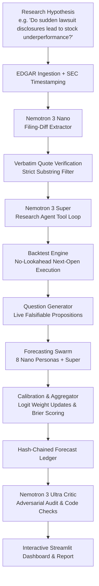

# ALBUS: Quant Research Copilot + Self-Calibrating Forecasting Swarm

[](https://opensource.org/licenses/MIT)
[](https://www.python.org/)
[](https://nebius.com)
[](https://build.nvidia.com)

**Track:** Best Apps and Agents | **Nebius x NVIDIA Global AI Hackathon**

---

## 1. Overview & One-Line Pitch

> **ALBUS** turns natural language investment hypotheses into rigorous, lookahead-free SEC filing backtests, then transforms the discovered signals into live, falsifiable forecasts scored over time in an append-only, hash-chained ledger.

Most financial chatbots hallucinate confident guesses. ALBUS tests every hypothesis against historical 10-K filings and split-adjusted prices, verifies every citation down to exact verbatim substrings, and uses an adversarial critic agent to actively poke holes in its own conclusions.

---

## 2. Architecture & Pipeline



### Specialized Model Roles
1. **Nemotron 3 Nano (`nvidia/nemotron-3-nano-30b-a3b`):** Fast, cheap bulk extraction of Item 1A filing diffs across years $t$ vs. $t-1$, and 8 diverse swarm forecasting personas.
2. **Nemotron 3 Super (`nvidia/nemotron-3-super-120b-a12b`):** Autonomous research agent driving quantitative tool execution, backtest specification, and swarm aggregation.
3. **Nemotron 3 Ultra (`nvidia/Nemotron-3-Ultra-550b-a55b`):** Skeptical critic and final adjudicator running deterministic lookahead/cost checks and adversarial audit.

---

## 3. Implemented Modules

| Phase | Module | Key Capabilities | Gate Status |
| :--- | :--- | :--- | :--- |
| **Phase 0** | **Setup & Rules** | MIT License, `.gitignore`, `.env.example`, pre-commit secret scanner, `AGENTS.md` rules. | Passed |
| **Phase 1** | **LLM Client & Cache** | Async OpenAI-compatible client for Nebius Token Factory, reasoning extraction, concurrency semaphore (10), exponential backoff retries, and SHA-256 disk cache. | Passed |
| **Phase 2** | **Data Layer** | SEC EDGAR fair-access ingest ($\le 10$ req/s), Item 1A Risk Factors parser with timezone-aware acceptance stamps, split-adjusted price loader with next-open execution. | Passed |
| **Phase 3** | **Filing-Diff Extractor** | Nemotron Nano extraction of newly added/removed risks, Pydantic schema repair loop, deterministic verbatim quote verification ($\ge 98\%$ precision). | Passed |
| **Phase 4** | **Backtest Engine** | Decile long/short walk-forward simulation, transaction cost modeling, Sharpe, max drawdown, turnover, bootstrap 95% CI, and hard `LookaheadBiasError` tripwires. | Passed |
| **Phase 5** | **Research Agent** | Autonomous tool loop with `run_backtest`, `get_stats`, `plot`, `list_filings`, $k$ variant tracker, and iteration caps. | *Active* |

---

## 4. Quick Start & Setup

### Prerequisites
- Python 3.11+
- `uv` (recommended) or standard `pip`

### Installation
```bash
# Clone the repository
git clone https://github.com/One-Hat/Albus.git
cd Albus

# Create virtual environment and install dependencies
uv venv
source .venv/bin/activate  # On Windows: .venv\Scripts\activate
uv pip install -e .
```

### Environment Configuration
Copy `.env.example` to `.env` and provide your credentials:
```bash
cp .env.example .env
```
```env
NEBIUS_BASE_URL=https://api.tokenfactory.nebius.com/v1
NEBIUS_API_KEY=your_nebius_api_key_here
EDGAR_USER_AGENT=ALBUS-QuantResearchCopilot/1.0 (researcher@example.com)
```

---

## 5. Verification & Testing

ALBUS includes comprehensive unit, integration, and gate tests:
```bash
# Run full test suite with no-sync offline mode
uv run --no-sync pytest -v

# Run secret scan check
python scripts/check_secrets.py
```

---

## 6. Project Rules & Anti-Leakage Guardrails

1. **Strict No-Lookahead (AGENTS.md Rule 9):** Trades execute strictly at the **next market open** ($09:30\text{ ET}$) following the SEC acceptance timestamp (`accepted_at`). Any attempt to trade at or before acceptance raises a [`LookaheadBiasError`](file:///d:/NVIDIA/src/backtest/engine.py#L24).
2. **Verbatim Substring Quotations (AGENTS.md Rule 6):** Every single cited risk claim must be an exact verbatim substring of the source filing. Paraphrases and hallucinated quotes are rejected by code.
3. **Pydantic Validation Everywhere:** All LLM outputs pass strict Pydantic schemas with automatic 2-step repair loops.
4. **Never Invent Model IDs (AGENTS.md Rule 3):** Model IDs are read strictly from [`config/models.yaml`](file:///d:/NVIDIA/config/models.yaml).
5. **No Secrets in Git (AGENTS.md Rule 7):** Automated pre-commit secret scanners guarantee credentials are never committed.

---

## 7. Disclaimer

> **Notice:** ALBUS is an academic and quantitative research tool designed for research demonstration and backtesting analysis. Nothing produced by ALBUS constitutes financial, legal, or investment advice.
