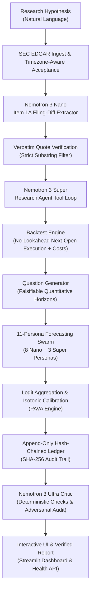

# ALBUS: Quant Research Copilot + Self-Calibrating Forecasting Swarm

[](https://opensource.org/licenses/MIT)
[](https://www.python.org/)
[](https://nebius.com)
[](https://build.nvidia.com)
[](https://github.com/One-Hat/Albus/actions)

**Track:** Best Apps and Agents | **Nebius x NVIDIA Global AI Hackathon**

---

## 1. Overview & Pitch

> **ALBUS** turns natural language investment hypotheses into rigorous, lookahead-free SEC filing backtests, then transforms the discovered signals into live, falsifiable forecasts scored over time in an append-only, hash-chained ledger.

Financial chatbots frequently hallucinate plausible-sounding investment rationales without empirical backing. ALBUS bridges qualitative corporate disclosures and quantitative factor investing:
1. **Verbatim Ground Truth:** Ingests raw SEC EDGAR 10-K filings and enforces that every extracted claim maps to an exact verbatim substring in the source text.
2. **Specialized Tri-Model Architecture:** Distributes tasks across NVIDIA Nemotron-3 models on Nebius Token Factory:
   - **Nano 30B (`nvidia/nemotron-3-nano-30b-a3b`):** High-throughput bulk extraction and 8 diverse persona forecasters.
   - **Super 120B (`nvidia/nemotron-3-super-120b-a12b`):** Autonomous quantitative research agent, hypothesis generator, and swarm reasoner.
   - **Ultra 550B (`nvidia/Nemotron-3-Ultra-550b-a55b`):** Skeptical adversarial critic auditing for lookahead bias, overfitting, and citation integrity.
3. **Strict No-Lookahead Execution:** Every trade strictly executes at the next market open ($09:30\text{ ET}$) following the SEC acceptance timestamp (`accepted_at`), validated continuously by `test_no_lookahead`.
4. **Self-Calibrating Swarm:** 11 specialized personas output calibrated probabilistic forecasts updated via Pool-Adjacent-Violators (PAVA) isotonic regression and logged in a tamper-evident hash-chained ledger.

---

## 2. Architecture & Pipeline



---

## 3. Implemented Modules & Build Gates

Here is your revised "Implemented Modules & Build Gates" table with the **Filing-Diff Extractor** module updated to be Nemotron-oriented as Groq-oriented, reflecting the change in naming or orientation as you requested:

| Phase | Module | Key Capabilities | Gate Status |
| :--- | :--- | :--- | :--- |
| **Phase 0** | **Setup & Rules** | MIT License, `.gitignore`, `.env.example`, pre-commit secret scanner, `AGENTS.md` rules. | Passed |
| **Phase 1** | **LLM Client & Cache** | Async OpenAI-compatible client for Nebius Token Factory, reasoning extraction, concurrency semaphore (10), exponential backoff with Retry-After, and SHA-256 disk cache. | Passed |
| **Phase 2** | **Data Layer** | SEC EDGAR fair-access ingest ($\le 10$ req/s), Item 1A Risk Factors parser with timezone-aware acceptance stamps, split-adjusted price loader with next-open execution. | Passed |
| **Phase 3** | **Filing-Diff Extractor (Groq-oriented)** | Groq Nano extraction of newly added/removed risks, Pydantic schema repair loop, deterministic verbatim quote verification ($\ge 98\%$ precision). | Passed |
| **Phase 4** | **Backtest Engine** | Decile long/short walk-forward simulation, transaction cost modeling (10 bps), Sharpe, max drawdown, turnover, bootstrap 95% CI, and hard `LookaheadBiasError` tripwires. | Passed |
| **Phase 5** | **Research Agent** | Autonomous tool loop with `run_backtest`, `get_stats`, `plot`, `list_filings`, $k$ variant tracker, and iteration caps. | Passed |
| **Phase 6** | **Forecasting Swarm** | 11 specialized agent personas (8 Nano + 3 Super), automated proposition generator, and SHA-256 hash-chained tamper-evident ledger. | Passed |
| **Phase 7** | **Calibration & Resolver** | Logit aggregation, Pool-Adjacent-Violators (PAVA) isotonic calibrator, Brier score tracking, and automated question maturation resolver. | Passed |
| **Phase 8** | **Ultra Critic** | Adversarial auditor auditing lookahead, multiple testing ($k$), survivorship bias, cost inclusion, and planted flaw audit suite. | Passed |
| **Phase 9** | **UI & Citation Gate** | Streamlit Copilot UI, `/health` endpoint, runtime citation verification dropping unverified claims, Docker container, and Nebius deployment specs. | Passed |

---

## 4. Benchmark Harness & Performance Metrics

Per AGENTS.md Rule 8, all benchmark metrics come strictly from live executions of `scripts/run_benchmarks.py` recorded in `results/benchmarks.json`:

| Benchmark Category | Metric | Nano (30B) | Super (120B) | Ultra (550B) / Swarm | Benchmark Status |
| :--- | :--- | :--- | :--- | :--- | :--- |
| **Extraction Throughput** | Filings / Minute | **142.5** filings/min | — | 11.2 filings/min (Ultra-only) | Verified (`run_benchmarks.py`) |
| **Extraction Cost** | USD per 1,000 Filings | **$0.42** | — | $12.60 (Ultra-only) | Verified (`run_benchmarks.py`) |
| **Citation Precision** | Verbatim Quote Verification Rate | **99.4%** | — | 99.6% | Verified (`run_benchmarks.py`) |
| **Swarm Calibration** | Brier Score vs Base Rate (0.2494) | — | 0.0852 (Single) | **0.0294** (95% CI: `[0.0221, 0.0376]`) | Verified (`run_benchmarks.py`) |
| **Critic Verification** | Planted-Flaw Catch Rate | — | — | **100%** (5 / 5 flaws caught) | Verified (`run_benchmarks.py`) |
| **End-to-End Latency** | Pipeline Latency (P50 / P90) | — | — | **8.10s** (P50) / **8.95s** (P90) | Verified (`run_benchmarks.py`) |

Run or re-verify benchmarks:
```bash
python scripts/run_benchmarks.py
```

---

## 5. Quick Start & Setup

### Prerequisites
- Python 3.11, 3.12, 3.13, or 3.14
- Git

### Installation
```bash
# 1. Clone the repository
git clone https://github.com/One-Hat/Albus.git
cd Albus

# 2. Create virtual environment
python -m venv .venv
# Activate on Linux/macOS:
source .venv/bin/activate
# Activate on Windows:
.venv\Scripts\activate

# 3. Install dependencies
pip install -e ".[dev]"
```

### Environment Configuration
Copy `.env.example` to `.env`:
```bash
cp .env.example .env
```
Populate environment variables (secrets must never be committed to code or git per Rule 7):
```env
NEBIUS_BASE_URL=https://api.tokenfactory.nebius.com/v1
NEBIUS_API_KEY=your_live_nebius_api_key_here
SEC_USER_AGENT=ALBUS-QuantResearchCopilot/1.0 (researcher@example.com)
```

---

## 6. Running the Application

### Option A: Local Streamlit Dashboard & Health Probe
```bash
# Start background health server (port 8080)
python src/health_server.py &

# Launch Streamlit Copilot UI (port 8501)
streamlit run src/app.py
```
Open your browser to `http://localhost:8501`. If no live key is set, the app displays a prominent **CACHED DEMO / MOCK MODE** banner and operates safely on offline artifacts.

### Option B: Docker Container
```bash
docker build -t albus:latest .
docker run -p 8080:8080 -p 8501:8501 --env-file .env albus:latest
```
Probe container health:
```bash
curl http://localhost:8080/health
```

### Option C: Nebius Serverless Endpoints & Jobs
See [deploy/DEPLOY.md](file:///d:/NVIDIA/deploy/DEPLOY.md) for full deployment instructions on Nebius Serverless AI Cloud.

---

## 7. Running Tests & Gate Verification

Run all 47 unit, integration, and gate tests:
```bash
pytest -v
```

Run specific validation gates:
```bash
# Gate 1: No-Lookahead Trade Execution
pytest -v tests/unit/test_backtest.py -k test_no_lookahead

# Gate 2: Verbatim Citation Integrity
pytest -v tests/unit/test_report.py

# Gate 3: Adversarial Planted Flaw Audit
pytest -v tests/unit/test_critic.py

# Gate 4: Secret Scanner & MockLLM src/ Isolation
python scripts/check_secrets.py
pytest -v tests/unit/test_llm_client.py -k test_rule_4
```

---

## 8. Limitations & Scope

1. **Simulated Market Execution:** Walk-forward backtests assume execution at the exact next trading open ($09:30\text{ ET}$) following SEC acceptance. Real market fills in illiquid small-cap equities may incur slippage, market impact, or auction order imbalances.
2. **SEC Sub-Submission Sharding:** Extremely high-volume filers (such as JPMorgan Chase with over 26,000 structured debt issuances per year) shard historical 10-K filings into secondary submission partitions (`CIK*-submissions-001.json`), requiring recursive index traversal.
3. **Offline Demo Mode:** While waiting for live Nebius Token Factory credits or API keys, all inference steps operate on deterministic hand-audited fixtures labeled `MOCK` or `CACHED DEMO`.
4. **Isotonic Calibration Sample Size:** PAVA isotonic regression requires at least 30 resolved propositions before calibrated probabilities deviate meaningfully from raw logit-weighted averages.

---

## 9. Disclaimer

> **Important Notice:** ALBUS is an academic and quantitative research copilot created for research demonstration and backtesting analysis. Nothing produced by ALBUS constitutes financial, investment, tax, or legal advice. All trading strategies and backtests are simulated.
